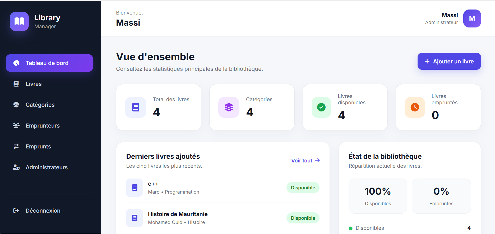
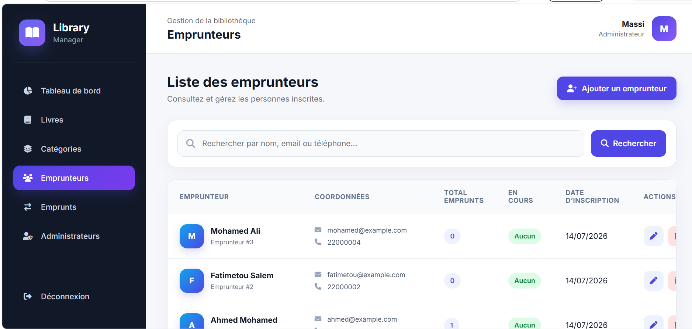
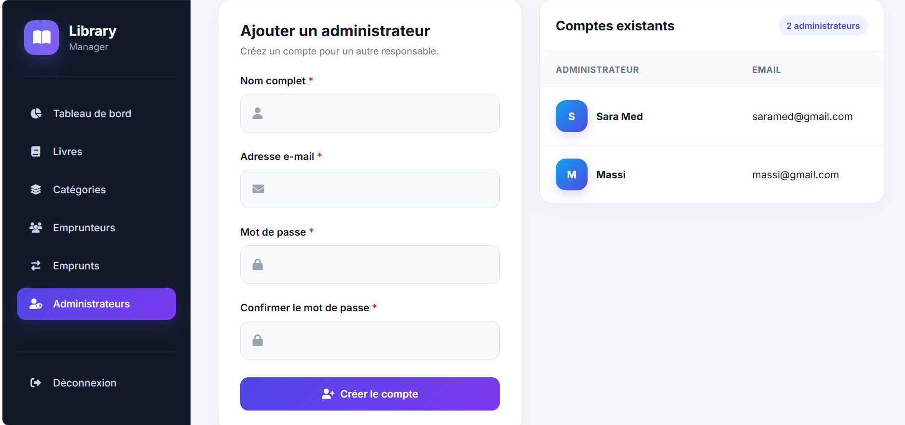

# 📚 Library Manager

A modern web application for managing libraries, books, borrowers, and loans.

## ✨ Features

- 🔐 Authentication system
- 📖 Books management (CRUD)
- 🏷️ Categories management
- 👥 Borrowers management
- 📅 Loan and return system
- ⚠️ Overdue loan alerts
- 👨‍💼 Multi-administrator support
- 📊 Dashboard with statistics
- 📱 Responsive design

---

## 🛠 Technologies Used

- PHP 8
- MySQL
- HTML5
- CSS3
- Font Awesome
- WAMP Server

---

## 📸 Screenshots

### Login Page


### Dashboard


### Books Management


### Loans Management


### Administrators Management


---

## ⚙️ Installation

### 1. Clone the repository

```bash
git clone https://github.com/massebgouha-dev/library-manager.git
```

### 2. Import the database

Import the file:

```text
database/library_manager.sql
```

### 3. Configure the database connection

Edit:

```text
config/db.php
```

### 4. Run the project

```text
http://localhost/library_manager/
```

---

## 📂 Project Structure

```text
library_manager/
├── assets/
├── books/
├── borrowers/
├── categories/
├── loans/
├── admins/
├── config/
├── dashboard.php
├── index.php
└── README.md
```

---

## 👨‍💻 Author

**Massebgouha Ahmednah**

- GitHub: https://github.com/massebgouha-dev
- Email: massimed89@gmail.com
